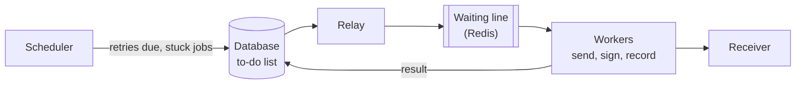

# ferrum-webhook-worker

The delivery engine of **Ferrum**, a service that delivers webhooks reliably. It takes saved events, sends them to the receivers, retries failures, parks the ones that never work, and recovers if it crashes.
The API that receives events is [`ferrum-webhook-gateway`](https://github.com/ferrum-webhooks/ferrum-webhook-gateway).



## How it behaves

- **Every delivery is attempted at least once**, even if a worker crashes. Occasionally a delivery is sent twice; every attempt carries the same message id so receivers can ignore the repeat.
- **Retries are scheduled, not slept.** The next try time is stored in the database; no worker waits.
- **Messages are signed** following the public [Standard Webhooks](https://www.standardwebhooks.com/) format.
- **Shutting down is safe:** the worker finishes the deliveries it has started first.
- One worker process delivers roughly 320 to 350 messages per second; run more copies for more.

How it recovers from every kind of crash: [engineering note 02](https://github.com/ferrum-webhooks/docs/blob/main/engineering/02-delivery-pipeline.md).

## Run it

```bash
python3 -m venv .venv && .venv/bin/pip install -r requirements.txt
cp .env.example .env            # database and Redis settings
.venv/bin/python -m worker.main
```
Easiest full setup: `infra/local/stack.sh up` in the [`infra`](https://github.com/ferrum-webhooks/infra) repository. All settings (retry count, timings, concurrency): [configuration](https://github.com/ferrum-webhooks/docs/blob/main/configuration.md).

## Tests

```bash
.venv/bin/python -m pytest -q        # 18 tests; needs Redis running on the default port (otherwise they are skipped)
```
With `TEST_DATABASE_URL` pointing to a throwaway PostgreSQL database (name contains `test`), 3 more tests run that check that several workers never do the same job twice.

## Code map

```
worker/main.py       start and stop              worker/delivery.py   one delivery attempt
worker/consumer.py   reads the waiting line       worker/relay.py      moves jobs to the waiting line
worker/scheduler.py  retries and repairs          worker/signing.py    message signatures
worker/health.py     health checks, metrics       worker/config.py     all settings
app/                 shared code (models.py, ssrf.py, tracing.py are copies of the gateway's; keep them identical)
```

MIT licensed.
